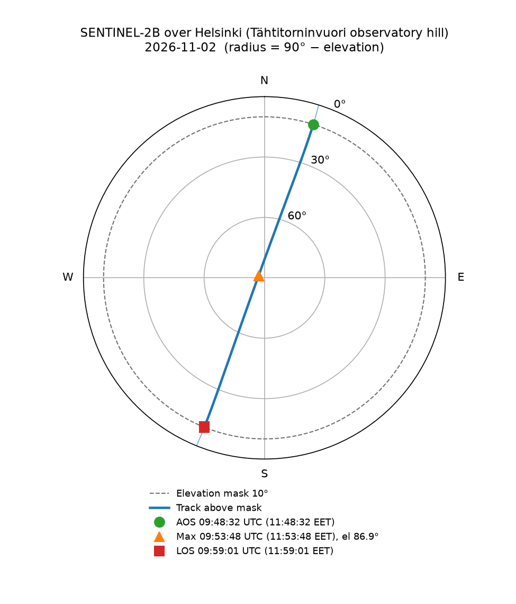

# satellite-pass-planner

`passplan` is a small command-line tool that predicts when a satellite is in contact
with a ground station. For each pass it reports:

- **AOS** (acquisition of signal): the satellite rises above an elevation mask
- **maximum elevation**
- **LOS** (loss of signal): the satellite sets below the mask
- duration

It uses public orbital data from CelesTrak and the standard SGP4 orbit model
(Simplified General Perturbations 4), prints times in both UTC and Finnish time, and
can draw a sky plot of a pass and say whether the pass can be seen by eye. See
[How it works](#how-it-works).

I built it to learn pass planning hands-on, the first step of contact scheduling in
mission operations. The code was written by an AI coding agent (Claude Code). I set the
goals and verified the results, partly by hand (see
[AI-assisted development](#ai-assisted-development)). The verification is the main part
of the work: the results are checked against an independent reimplementation, physical
bounds and two other programs. A Finnish explanation of the underlying physics, with a
short usage guide, is in
[`docs/pass_prediction_explained_fi.pdf`](docs/pass_prediction_explained_fi.pdf)
(LaTeX source `docs/pass_prediction_explained_fi.tex`).



**Verification in brief** (details in [`docs/verification.md`](docs/verification.md)):

- A separate NumPy implementation of the geometry agrees with the tool to within
  0.25 s in rise and set times and 0.002° in elevation.
- Against Heavens-Above on 2026-11-12, 17 of 18 pass times from two public places were
  identical to the second, and one differed by 1 s. Against SkySafari, directions agreed
  to within 0.02°.
- The comparisons by hand found one bug (a clipped AOS printed one second early). It is
  fixed and covered by a regression test.
- 69 automated tests. 65 of them also run on GitHub Actions after every push; the 4 that
  need the 17 MB ephemeris are skipped there.

## How it works

1. **Orbital data.** The tool downloads the satellite's current orbital elements from
   [CelesTrak](https://celestrak.org), a free public service, and keeps them for
   2 hours. The elements come from the US Space Force, which fits them to tracking
   observations. Two formats hold the same numbers:
   - TLE (two-line element set): two fixed-width 69-character text lines
   - OMM (Orbit Mean-Elements Message): the same fields with names, here as JSON

   The tool downloads OMM, because the TLE's fixed columns cannot hold the 6-digit
   catalog numbers given to objects catalogued from 2026-07-11 onwards (for example
   ICEYE-X84, NORAD 101122). A TLE or OMM file can also be given directly.
2. **Orbit.** The elements go into SGP4, the orbit model they were fitted for, through
   [Skyfield](https://rhodesmill.org/skyfield/). For each moment this gives the
   satellite's position, and from it the direction seen from the ground station:
   azimuth (compass direction) and elevation (angle above the horizon).
3. **Passes.** A pass starts (AOS) when the elevation rises above the mask, 10° by
   default, and ends (LOS) when it sets below it. Skyfield's event search finds these
   moments to within 0.5 s.
4. **Visibility** (optional). A pass is visible by eye while the satellite is in
   sunlight and the Sun is more than 6° below the horizon. The Sun's position comes
   from the JPL DE421 ephemeris, a table of Solar System positions.

## Installation

Create a conda environment. Python 3.14 is used because conda-forge has no
sgp4 ≥ 2.26 build for Python 3.15 yet, and without it Skyfield 1.54 fails to import.

```bash
conda create -n passplan -c conda-forge "python=3.14" skyfield "sgp4>=2.26" \
  pytest matplotlib ruff tectonic
conda activate passplan
```

`tectonic` is only needed to rebuild the explanation PDF
(`cd docs && tectonic pass_prediction_explained_fi.tex`).

Run the tool from the repository root (no install step):

```bash
# ISS over Helsinki, next 2 days, mask 10°
python -m passplan --norad 25544
python -m passplan --norad 42063 --station turku --days 1 --plot pass.png
python -m passplan --norad 25544 --lat 61.45 --lon 23.85 --altitude-m 120 \
  --min-elevation 5
# offline
python -m passplan --tle-file tests/data/iss.tle --start 2026-11-01T00:00:00
# by name; can I see it by eye?
python -m passplan --name "cosmos 1833" --min-elevation 0 --visibility
# a 6-digit catalog number (OMM only)
python -m passplan --name "ICEYE-X84" --days 1 --min-elevation 0 --plot x84.png
```

### Options

- **`--norad N`**
  - NORAD catalog number, 5 or 6 digits.
  - Downloaded from CelesTrak as OMM JSON and cached in `.tle_cache/` for 2 hours.
- **`--tle-file PATH`**
  - Read a 2- or 3-line TLE, or a CelesTrak OMM JSON file, instead (works offline).
  - JSON is recognised by its first character (`[` or `{`).
- **`--name TEXT`**
  - Search CelesTrak by part of the name (`NAME=` query, cached 2 h).
  - One match is used directly. Several are listed with their NORAD numbers, so you
    can pick one with `--norad`.
- **`--cache-dir DIR`**
  - Cache for element sets and the ephemeris (default: `.tle_cache/`).
- **`--station NAME`**
  - Built-in station `helsinki` (default) or `turku`, or a private station from your
    own file (see below).
- **`--lat`, `--lon`, `--altitude-m`**
  - Any other location: WGS84 geodetic latitude and longitude, height above the
    ellipsoid.
- **`--start`, `--days`**
  - Search window (default: now, 2 days).
  - `--start` is ISO 8601, UTC if no offset is given.
- **`--min-elevation`**
  - Elevation mask in degrees (default: 10).
- **`--plot PNG`, `--plot-pass N`**
  - Save a sky plot. Default: the highest complete pass.
  - A bare file name such as `pass.png` is saved in `plots/` (created if
    missing); a path with a directory is used as given.
- **`--visibility`**
  - Also say whether each pass can be seen by eye (see
    [How it works](#how-it-works)).
  - Downloads the JPL DE421 ephemeris (17 MB) into the cache directory on first use.
- **`-h`, `--help`**
  - List the options and their defaults. Works for all three commands: `passplan`,
    `passplan.schedule` and `passplan.heavens_above`.

### Example output

```
Satellite      ISS (ZARYA)  NORAD 25544
Elements       TLE  tests/data/iss.tle
Epoch          2026-10-31 10:25:39 UTC  (age +0.57 d at window start, +1.57 d at window end)
Orbital period 92.96 min (from the mean motion)
Ground station Helsinki (Tähtitorninvuori observatory hill)  60.1618°N 24.9526°E 31 m
Window         2026-11-01 00:00:00 UTC + 1 d, elevation mask 10°

Pass 1
  AOS  2026-11-01 00:42:50 UTC  (02:42:50 EET)  az 231.2°
  MAX  2026-11-01 00:45:22 UTC  (02:45:22 EET)  az 183.0°  el  19.6°
  LOS  2026-11-01 00:47:54 UTC  (02:47:54 EET)  az 134.8°
  Duration 5 min 03 s
Pass 2
  AOS  2026-11-01 02:19:40 UTC  (04:19:40 EET)  az 232.0°
  ...
```

Times are printed truncated to whole seconds (Heavens-Above appears to do the same).
The event search itself is accurate to a few tenths of a second, so two programs
can differ by one printed second when the true time is close to a whole second.

The tool also handles these edge cases and reports them in words:

- a pass already in progress at the window start, or still in progress at the end.
  The duration is then shown as "at least", and MAX is the highest point inside the
  window, not the peak of the whole pass.
- a satellite that never rises above the mask. The tool reports the highest elevation
  reached.
- a geostationary satellite that stays visible the whole time.

**Comparing with other programs.** Other programs give rise and set at their own
limit, not at the tool's default 10° mask. With the 10° mask, LOS comes minutes earlier:
for one Cosmos 1833 pass over Turku on 2026-11-02 the 10° LOS was 2 min 25 s before the
horizon LOS.

- **Heavens-Above** gives rise and set at the geometric horizon: use
  `--min-elevation 0`. Its pass list hides passes that peak below 10°, and add
  `showall=t` to its URL to see daylight passes of faint satellites.
- **SkySafari** gives rise and set when the geometric elevation is −34′, the usual
  astronomical convention that allows for refraction at the horizon: use
  `--min-elevation -0.57`. Its peak elevations and directions matched the tool's
  geometric values directly.
- `python -m passplan.heavens_above --station turku --norad 25544 --browser chrome`
  opens Heavens-Above's pass list for the same satellite at the station's exact
  coordinates, with times in UTC. For a private station the coordinates go only to the
  browser and are not printed. `--browser` is `default`, `chrome`, `safari` or
  `firefox`.

### Ground station coordinates

- **Helsinki**
  - Now: 60.1618132 N, 24.9525605 E, 31 m.
  - Source: the summit of Tähtitorninvuori (Observatory Hill), OpenStreetMap node
    11360115982 (natural=peak, ele=31), retrieved 2026-11-05.
  - The Heavens-Above comparison of 2026-10-31 (see
    [`docs/verification.md`](docs/verification.md)) was made for the earlier default
    site, 60.1527 N, 24.9254 E, 10 m. The tests keep using that site for it
    (`HEAVENS_ABOVE_SITE` in `tests/conftest.py`).
- **Turku**
  - Now: 60.4517221 N, 22.2668467 E.
  - Source: Kauppatori market square, OpenStreetMap Nominatim (way 621404185),
    retrieved 2026-10-31.

The Turku source gives no height, so it uses an assumed 10 m. A few tens of
metres changes elevation angles negligibly. For the same reason it does not matter here
that the tool's height is measured from the WGS84 ellipsoid rather than from sea level.

### Private stations (e.g. your home)

Locations you do not want in the repository go in a JSON file outside it, by default
`~/.config/passplan/stations.json`. The environment variable `PASSPLAN_STATIONS` can
point to another file. Edit it with any text editor, for example
`nano ~/.config/passplan/stations.json`.

```json
{
  "default": "home",
  "stations": {
    "home": {"name": "Home", "latitude_degrees": 60.0, "longitude_degrees": 22.0,
             "altitude_m": 5}
  }
}
```

- Each entry becomes a `--station` choice (`--station home`). The schedule command
  accepts it too.
- `"default"` is optional and makes that station the default.
- The output shows only the name of a private station, never its coordinates, so the
  output is safe to paste or screen-share.
- The tests ignore this file.

## Verification

The full description is in [`docs/verification.md`](docs/verification.md):

- a second, independent implementation of the geometry
- physical bounds checked for every pass
- edge cases
- comparisons with Heavens-Above and SkySafari
- optical visibility checks
- what verification cannot show

Run the checks:

```
$ ruff check . && ruff format --check . && pytest
All checks passed!
69 passed
```

The same checks run on GitHub Actions after every push
(`.github/workflows/tests.yml`). There the 4 test cases that need the ephemeris are
skipped, because the 17 MB DE421 file is not downloaded.

## Extension: single-antenna contact scheduling

`python -m passplan.schedule` takes several satellites and finds the passes of each one
over one station. It then chooses which passes a single antenna can serve. Satellites
are given in priority order, and the first one is the most important:

```bash
python -m passplan.schedule --satellite tests/data/iss.tle \
  --satellite tests/data/sentinel2b.tle --satellite tests/data/landsat9.tle \
  --satellite tests/data/sentinel2a.tle --satellite tests/data/noaa20.tle \
  --start 2026-11-01T00:00:00 --days 1 --slew-minutes 2
```

A satellite can also be given as a NORAD number, in which case its elements are downloaded
from CelesTrak.

**Rule (greedy).** Candidates are taken in this order:

1. priority
2. highest maximum elevation, because a high pass is longer and has a shorter range
3. earliest AOS, so that the result is deterministic

A candidate is accepted if its AOS is at least the slew time (default 2 min) after the
LOS of every accepted contact before it, and its LOS is at least the slew time before
every accepted contact after it. Otherwise it is rejected, and the reason names the
contact that blocked it.

```
P1, P2, ... = priority in the order the satellites were given (P1 = most important)

Scheduled contacts (28, total 3 h 21 min 32 s):
  + ISS (ZARYA) (P1)       11-01 00:42:50-00:47:54 UTC [02:42 EET]  max el 19.6°
  + NOAA 20 (JPSS-1) (P5)  11-01 01:04:57-01:15:44 UTC [03:04 EET]  max el 74.2°
  ...
Rejected contacts (4):
  - SENTINEL-2A (P4)       11-01 08:49:01-08:58:51 UTC [10:49 EET]  max el 40.6°
      reason: only 0.4 min apart from higher-ranked contact SENTINEL-2B (P2)
      11-01 08:39:02-08:48:35 UTC [10:39 EET]  max el 35.3°
  ...
```

(The reason is printed on one line; it is wrapped here.)

Sentinel-2A and -2B share one orbit about half an orbit apart, so their passes follow
each other within minutes. With a single antenna, the lower-priority twin loses.

**Tests** (`tests/test_schedule.py`):

- A five-pass example worked out by hand, with 2 min slew and with 0 min slew. The two
  give different results, which shows the slew time is applied.
- The exact boundary of the gap (gap = slew is allowed).
- On the real five-satellite case over 2 days:
  - accepted contacts are separated by at least the slew time
  - every rejection is caused by an accepted contact of equal or higher priority
  - all priority-1 passes are kept

**What this simplification leaves out, and why real networks optimise instead.** A
greedy rule is easy to explain, but it is not optimal. One high-elevation pass can
block two shorter passes that together would deliver more data, and the greedy choice
never revisits that decision. Operational ground networks usually treat scheduling as
an optimisation problem, for example integer programming or heuristic search. The goal
is to maximise delivered data or mission value under many constraints that this tool
ignores:

- several antennas and stations
- partial contacts: using only the best part of a pass, or shortening one pass to fit
  another
- per-satellite data volumes, on-board storage and latency requirements
- link budgets: the data rate depends on elevation and range
- antenna slew time that depends on the actual angle between LOS and the next AOS (a
  constant here), and keyhole limits
- set-up and tear-down times, maintenance windows, and contact requests that must be
  fulfilled at least N times per day
- regulatory constraints on frequencies

A pass that is clipped by the end of the search window is scheduled as it is, without
a mark in the output.

## Limitations

- **Element set (TLE/OMM) and SGP4 accuracy.** "In general, TLE data is accurate to
  about a kilometer or so at epoch and it quickly degrades" (Vallado, Crawford,
  Hujsak & Kelso 2006, *Revisiting Spacetrack Report #3*, AIAA 2006-6753).
  - Wikipedia's SGP4 article gives a growth of "~1–3 km per day" and cites the same
    paper, but I could not find that figure in the paper's text, so treat it as
    unverified.
  - Skyfield's documentation advises re-downloading once elements are "a few days
    old".
  - In the along-track direction, 1 km corresponds to about 0.13 s in a LEO pass time.
  - The tool warns when the window extends more than 3 days from the epoch. The 3-day
    threshold is my reading of "a few days", not a published limit.
- **Not modelled:**
  - atmospheric refraction, which makes satellites appear slightly higher near the
    horizon. `--min-elevation -0.57` approximates the usual refraction at the horizon
    (34′) for rise and set times, as SkySafari does.
  - terrain or building horizon masks (the mask is a single elevation for all
    azimuths)
  - antenna slew rate and keyhole limits near the zenith
  - light-time
  - polar motion (metres)
- **Mask crossings** are located to Skyfield's 0.5 s search tolerance.
- **Catalog numbers** above 339999 are rejected: sgp4 stores the number in its Alpha-5
  form, which ends there (sgp4 2.26, `sgp4/alpha5.py`). Today's numbers are near 101000.
- **"Highest point"** is the maximum elevation. For a circular orbit this coincides
  with the time of closest approach (TCA) to within the search tolerance, but it is
  not computed as a range minimum.

## Data source and terms of use

The Sun's position for `--visibility` comes from the JPL DE421 ephemeris, loaded
through Skyfield.

Orbital elements come from [CelesTrak](https://celestrak.org) (Dr. T.S. Kelso), which
describes itself as "a 501(c)(3) non-profit" (front page, read 2026-11-05). The GP
data originates from the US Space Force's 18th Space Defense Squadron. The query format
and usage rules were read from CelesTrak's "A New Way to Obtain GP Data" and "Usage
Policy" pages on 2026-10-31.

The tool follows the policy:

- It downloads one satellite at a time, only when the local copy is older than 2 hours
  (CelesTrak updates GP data every 2 hours).
- It sends an identifying User-Agent.
- On any non-200 response it stops and reports instead of retrying.

CelesTrak provides the data free of charge and asks users to "adhere to our usage
policy". I found no license or redistribution statement. The element sets in
`tests/data/` (seven TLEs retrieved 2026-10-31, and one TLE plus two OMM files
retrieved 2026-11-05) are small snapshots kept for reproducible tests. Each TLE file
records its retrieval time; the OMM files are listed in `tests/data/SOURCES.md`.

## AI-assisted development

The code, tests and documentation in this repository were written by an AI coding
agent (Claude Code, Claude Opus 5.5). My part:

- defining the goals and the verification criteria (independent reference values,
  physical bounds, external comparison)
- deciding the scope
- running the comparisons with Heavens-Above and SkySafari by hand, from three places,
  and reporting the differences back (see [`docs/verification.md`](docs/verification.md)).
  The first Heavens-Above comparison, on 2026-10-31, was fetched by the agent itself.
- reviewing the results

## License

MIT, see [`LICENSE`](LICENSE). The element sets in `tests/data/` come from CelesTrak
and are not covered by this license (see "Data source and terms of use").
